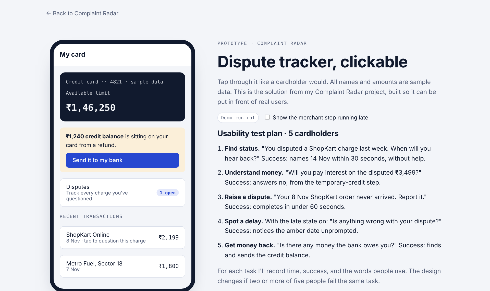
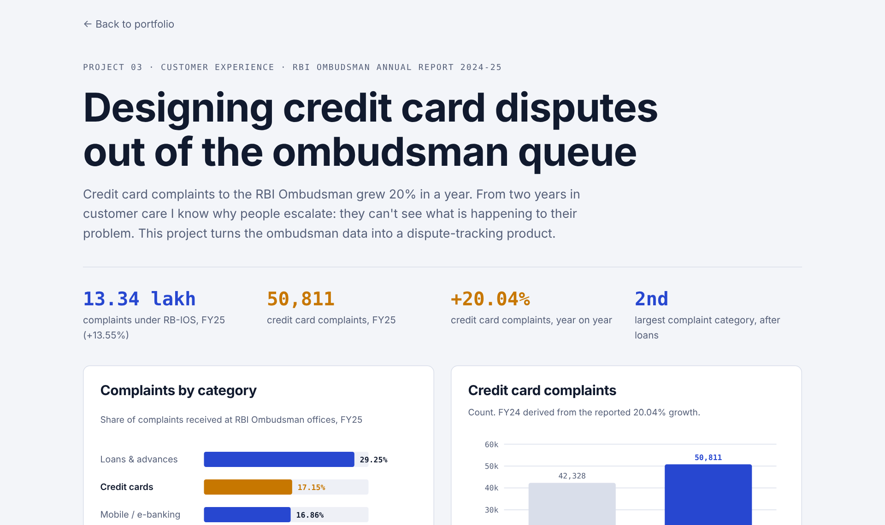

# Complaint Radar

**Credit cards became the second-largest complaint category at the RBI Ombudsman in FY25.** This project turns that data into an in-app dispute tracker, built as a clickable prototype with a usability test plan.

[**Try the prototype**](https://abhinavspambox.github.io/projects/complaint-radar/prototype.html) · [Live dashboard](https://abhinavspambox.github.io/projects/complaint-radar/) · [Portfolio](https://abhinavspambox.github.io/)

## The signal

| Measure (FY 2024-25) | Value |
| --- | --- |
| Complaints under RBI's Integrated Ombudsman Scheme | 13.34 lakh (+13.55%) |
| Credit card complaints | 50,811 (+20.04%) |
| Credit cards' share of complaints | 17.15%, second after loans |

## Why customers escalate

From two years in customer care: people escalate when they can't see what is happening to a dispute. They get a reference number, no timeline, and call again to explain the problem from the start.

## The product

An in-app dispute tracker with stage-by-stage status, an SLA countdown that turns amber when a step runs late, document upload, automatic refund of credit balances (the issue behind an RBI penalty on one issuer in 2025), and proactive updates.

**North star:** ombudsman escalations per 10,000 cards. **Guardrails:** chargeback loss rate, time to first response, CSAT.

## Usability test plan

Five cardholders, five tasks: find status, understand interest on a disputed amount, raise a dispute, spot a delay, get a credit balance back. The design changes wherever two or more people fail the same task. *Status: not yet run.*

## Files

| File | Contents |
| --- | --- |
| `prototype.html` | Clickable prototype (open in a browser; sample data only) |
| `index.html` | Dashboard |
| `data.csv`, `analysis.py` | Complaint shares by category and the script behind the numbers |

---

Part of [Abhinav Kumar Tarkar's product portfolio](https://abhinavspambox.github.io/). Figures are compiled from public RBI and NPCI releases as reported in the press; every row links to its source. Product proposals are my own and do not reflect any employer's plans.
